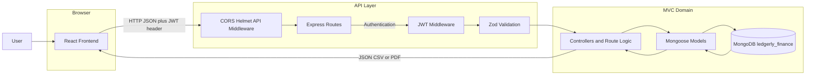
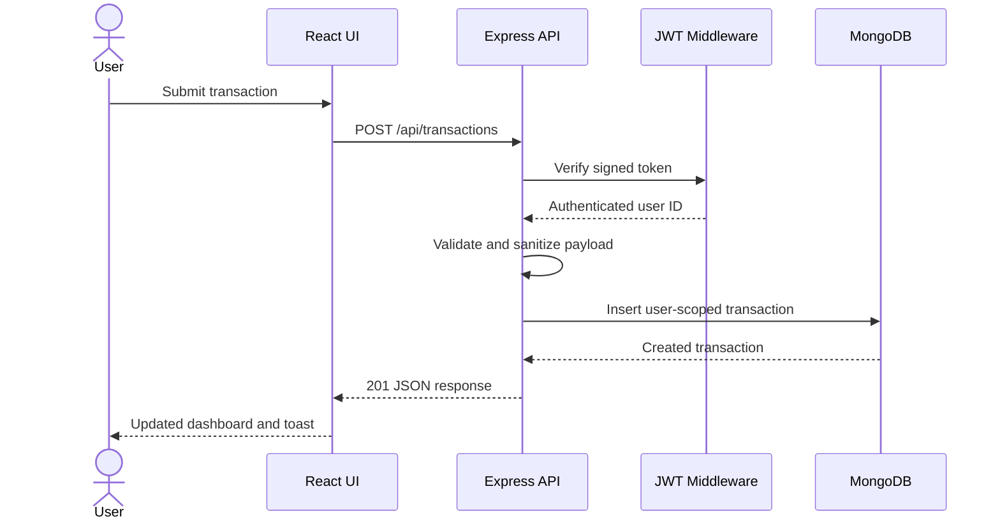
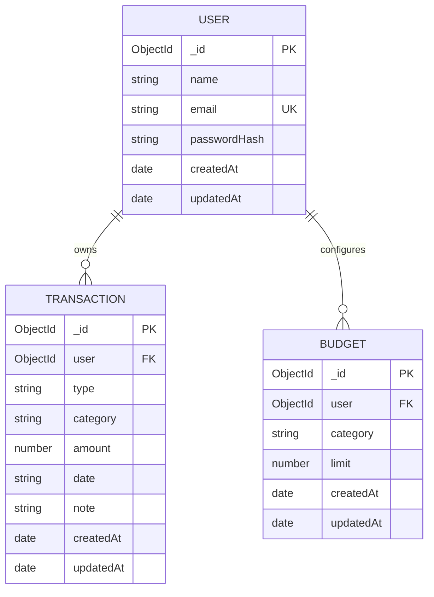

<div align="center">


[](https://react.dev/)
[](https://vitejs.dev/)
[](https://expressjs.com/)
[](https://www.mongodb.com/)
[](https://jwt.io/)

**A modern full-stack personal finance application for recording transactions, setting category budgets, analyzing cash flow, and exporting financial reports.**

</div>

---

## ✨ Why Monetra

Monetra turns everyday financial activity into a clear and searchable dashboard. It is designed around a simple workflow: sign in securely, record income or expenses, review trends, set category limits, and export only the data you need.

### Core experience

| Area | What users can do |
|---|---|
| **Dashboard** | Review balance, income, expenses, monthly trends, category spending, and recent activity |
| **Cash-flow chart** | Switch between week, month, 3-month, 6-month, and 12-month views |
| **Transactions** | Create, edit, delete, search, filter, and export transactions |
| **Categories** | Use standard expense categories or define a custom `Other` category |
| **Budgets** | Set and update spending limits for common monthly expense categories |
| **Authentication** | Sign up, log in, update profile information, and change passwords |
| **Appearance** | Use polished light and dark themes with locally stored preferences |
| **Exports** | Download filtered results as spreadsheet-friendly CSV or paginated PDF |

---

## 🎨 Interface highlights

- Responsive desktop and mobile navigation
- Accessible password visibility controls with local eye icons
- Custom labeled validation errors on forms and fields
- Local transaction and server-side cash-flow aggregation
- Theme-aware cards, tables, dialogs, inputs, charts, and empty states
- Currency formatting for Indian Rupees
- Toast feedback for successful and failed actions
- Empty, loading, error, and no-results states

---

## 🧱 Technology stack

### Frontend

- React 19
- Vite 8
- JavaScript ES modules
- Tailwind CSS integration
- Custom responsive CSS and theme variables
- Lucide React icons
- Recharts for category visualization
- Playwright for browser-level validation

### Backend

- Node.js
- Express 5
- MongoDB with Mongoose 9
- Zod validation
- JSON Web Tokens
- bcrypt password hashing
- PDFKit PDF generation
- Helmet and CORS security middleware

---

## 🏗️ Architecture

Monetra follows an MVC-style request flow. The React client communicates exclusively through the REST API, while the Express routes coordinate validation, authentication, controllers, models, and MongoDB persistence.



### Request lifecycle



---

## 🗃️ Data model



The database name is `ledgerly_finance`. Transaction and budget records are always scoped by the authenticated user's MongoDB object ID.

---

## 📂 Project structure

```text
Monetra/
├── src/
│   ├── App.jsx                  # Pages, UI components, state, and validation
│   ├── App.css                  # Application themes and responsive styling
│   ├── api.js                   # API client, token handling, timeout and errors
│   ├── assets/
│   │   ├── eye.svg              # Local password visibility icon
│   │   └── eye-off.svg          # Local password visibility icon
│   ├── index.css                # Global styles
│   └── main.jsx                 # React entry point
├── server/src/
│   ├── config/db.js             # MongoDB connection and shutdown handling
│   ├── controllers/
│   │   └── transactions.js      # Dashboard cash-flow aggregation
│   ├── middleware.js            # JWT auth, validation and global errors
│   ├── models/
│   │   ├── User.js
│   │   ├── Transaction.js
│   │   └── Budget.js
│   ├── routes/
│   │   ├── auth.js              # Signup, login, profile, password
│   │   ├── budgets.js           # Budget CRUD and validation
│   │   └── transactions.js      # CRUD, summaries, CSV, and PDF
│   └── index.js                 # Express startup, CORS and middleware
├── public/                      # Browser assets
├── e2e/                         # Playwright browser tests
├── package.json                 # Frontend scripts and dependencies
└── server/package.json          # Backend scripts and dependencies
```

---

## 🚀 Getting started

### Prerequisites

- Node.js 20 or newer
- npm
- MongoDB running locally, or a MongoDB Atlas connection string

### 1. Clone the repository

```bash
git clone https://github.com/parthivjp/Monetra.git
cd Monetra
```

### 2. Install dependencies

```bash
npm install
npm install --prefix server
```

### 3. Configure frontend environment

Create `.env` from `.env.example`:

```dotenv
VITE_API_URL=http://localhost:5000/api
```

### 4. Configure backend environment

Create `server/.env` from `server/.env.example`:

```dotenv
NODE_ENV=development
PORT=5000
CLIENT_URL=http://localhost:5173,http://localhost:5174
JWT_SECRET=replace-with-a-random-secret-at-least-32-characters
JWT_EXPIRES_IN=7d
MONGO_URI=mongodb://127.0.0.1:27017
DB_NAME=ledgerly_finance
```

`JWT_SECRET` must be replaced before production. The backend also requires a strong secret and database connectivity.

### 5. Start local MongoDB

Use a local MongoDB installation, MongoDB Compass, Docker, or MongoDB Atlas.

### 6. Run the application

Start both frontend and backend:

```bash
npm run dev:full
```

Or run services separately:

```bash
# Terminal 1
npm run server

# Terminal 2
npm run dev
```

### Default local URLs

| Service | URL |
|---|---|
| Frontend (Vite) | `http://localhost:5174` or `http://localhost:5173` |
| Backend API | `http://localhost:5000/api` |
| Health check | `http://localhost:5000/api/health` |

---

## 🔌 API overview

All protected endpoints require:

```http
Authorization: Bearer YOUR_JWT_TOKEN
```

### Authentication

| Method | Endpoint | Description |
|---|---|---|
| `POST` | `/api/auth/signup` | Create an account |
| `POST` | `/api/auth/login` | Authenticate and receive a JWT |
| `GET` | `/api/auth/me` | Get the current user profile |
| `PUT` | `/api/auth/me` | Update the current user's name |
| `PUT` | `/api/auth/password` | Change the current user's password |

### Transactions

| Method | Endpoint | Description |
|---|---|---|
| `GET` | `/api/transactions` | List authenticated user's transactions |
| `POST` | `/api/transactions` | Create a transaction |
| `PUT` | `/api/transactions/:id` | Update a transaction |
| `DELETE` | `/api/transactions/:id` | Delete a transaction |
| `GET` | `/api/transactions/summary?range=week` | Get cash-flow chart buckets |
| `GET` | `/api/transactions/export/csv` | Download a filtered CSV report |
| `GET` | `/api/transactions/export/pdf` | Download a filtered PDF report |

Supported summary ranges: `week`, `month`, `3`, `6`, and `12`.

Supported export filters:

```text
search=<text>&type=<income|expense>&category=<category>&startDate=<YYYY-MM-DD>
```

### Budgets

| Method | Endpoint | Description |
|---|---|---|
| `GET` | `/api/budgets` | Get the current user's category budgets |
| `PUT` | `/api/budgets` | Create or update category budget limits |

---

## 📤 Filtered exports

CSV and PDF exports use the same user-scoped filters as the Transactions screen.

- Search matches transaction categories and notes
- Type filters income or expense entries
- Category filters exact category names
- Start date includes the selected date and newer transactions
- CSV rows are UTF-8 encoded and protected from spreadsheet formula injection
- PDF exports include a table header, complete rows, wrapped text, and pagination

Example:

```text
/api/transactions/export/csv?type=expense&category=Food&startDate=2026-11-01
```

---

## 🛡️ Security and validation

- JWT authentication on protected API routes
- Short-lived bearer sessions with configurable expiration
- bcrypt password hashing with 12 salt rounds
- Password strength and profile validation on the client and server
- MongoDB object ownership checks for transaction updates and deletions
- User-scoped transaction, budget, summary, and export queries
- CORS origin allowlisting with local development support
- Helmet security headers
- Request body size limits
- Authentication rate limiting
- Zod request validation
- MongoDB date and amount validators
- Centralized structured API error responses
- CSV formula-injection protection

---

## 🧪 Validation and scripts

### Frontend scripts

```bash
npm run dev         # Start Vite development server
npm run build       # Create production build
npm run lint        # Run Oxlint
npm run preview     # Preview the production build
npm run test:e2e    # Run Playwright browser tests
```

### Backend scripts

```bash
npm run server --prefix .        # Start backend in watch mode
npm run start --prefix server    # Start backend normally
npm test --prefix server         # Run backend Node tests
```

### Recommended verification

```bash
npm run build
npm run lint
npm run test:e2e
npm test --prefix server
```

For end-to-end tests, ensure both MongoDB and the application services are running.

---

## 🌗 Theme support

Monetra stores the selected appearance in browser local storage. The theme state controls document-level variables used across navigation, cards, dialogs, inputs, charts, tables, buttons, and feedback components.

- `light`: clean warm surfaces with strong contrast
- `dark`: low-glare navy surfaces with readable accent colors

---

## 🧭 Roadmap

- [ ] Deploy frontend and backend to managed hosting
- [ ] Add recurring transaction templates
- [ ] Add end-of-month budget notifications
- [ ] Add multi-account and wallet support
- [ ] Add richer date-range exports
- [ ] Add backup and restore tools
- [ ] Add more dashboard analytics and forecasting

---

## 🤝 Contributing

Contributions are welcome.

1. Fork the repository
2. Create a feature branch
3. Make focused, tested changes
4. Run lint, build, and browser validation
5. Open a pull request with a clear description

Please preserve the existing MVC separation, user-scoped database queries, responsive UI behavior, and structured validation error format.

---

## 📄 License

No license has been specified yet. Add a `LICENSE` file before publishing this project for general reuse.

---

<div align="center">


<sub>Built for clear decisions, consistent tracking, and healthier financial habits.</sub>

</div>
